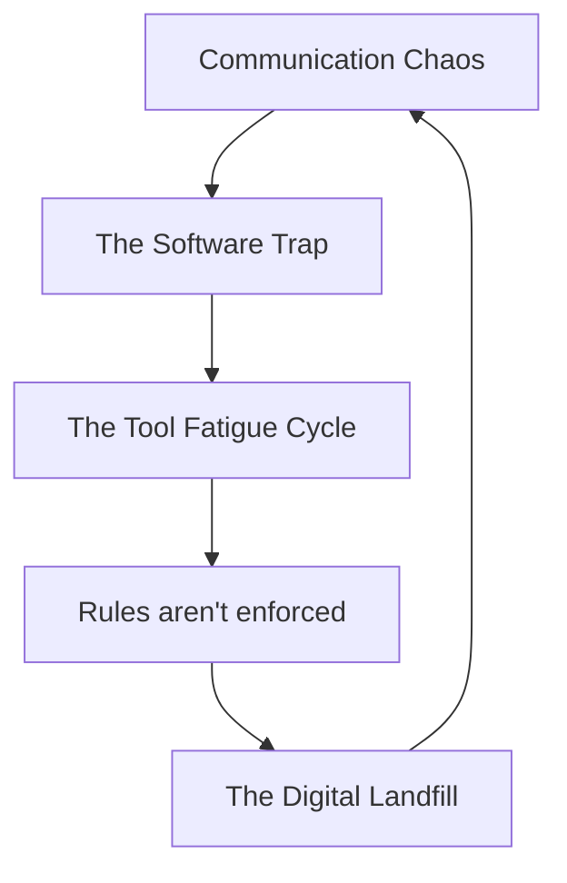

# Why Engineering Needs Data Hygiene, Not More Software

### The Hidden Tax of the Engineering Trench

In engineering consulting, manufacturing, and construction, the most expensive part of a project isn't the complex calculation, the structural analysis, or the CAD design work—it’s the hunt for the right information.

Teams waste hours wading through communication chaos: conflicting file versions, unrecorded calls, buried chat threads and critical answers hidden inside the email thread of an entirely different project.

Instead of addressing the root cause, leadership reflexively reaches for an expensive band-aid: procure yet another SaaS proprietary platform.

Adding another dashboard on top of a broken pipeline isn't a solution. **IT IS THE PROBLEM.**

### The Software Trap: Buying Band-Aids for Human Problems

Before you even realize it, the team is already waist-deep in the quicksand of [[enshittification]], with no possibility of leaving the SaaS without abandoning your boots in the mud.

Assuming software will magically enforce order triggers a vicious feedback loop:

Software cannot fix a human process problem. Without basic discipline, adding another proprietary layer only deepens the clutter.

Unverified changes and scattered data drain project margins and lead times. When information is fragmented, engineers waste hours playing digital detective: hunting for the latest spec, checking email chains, or guessing which subfolder holds the true drawing. 

Working off outdated baselines invites costly rework and liability risks. When teams spend more time verifying where data lives than actually engineering, productivity plummets.

### Why the "Real" Solution Doesn't Come in a Box

Why do firms keep buying tools that don't fix the problem? The uncomfortable truth is that **the actual solution doesn't exist as a product you can buy.**

Software companies cannot monetize discipline. Having you ruthlessly organize your files, and do the hard, unglamorous work of information governance is not something they can package into a slick software subscription. You can't sell a culture of accountability.

As the Second Law of Thermodynamics dictates: everything naturally tends toward increasing entropy and disorder. Fighting that decay doesn't require a small monthly fee; it requires daily, intentional hygiene.

### The Antidote: Data Hygiene

The antidote to information chaos isn't more technology; it's [[radical]], uncompromising, data hygiene. The discipline required to fix an engineering workflow costs zero dollars in software licensing.

You don’t have to get it all right on day one. Start with the single most critical friction point—whether that's ECOs, field reports, or manufacturing documents—and focus on getting **1% better today than you were yesterday**. Compound that daily, and you’ll improve nearly **37-fold in a year**. Fall backward by 1% each day, and you’ll shrink to a fraction of where you started.

$$
\text{Growth: } 1.01^{365} \approx 37.78
$$
$$
\text{Decay: } 0.99^{365} \approx 0.025 
$$

Here are some starting points that that everyone—from senior directors to junior drafters—should implement:

- **The Single Source of Truth:** A mandatory, agreed-upon repository where every official requirement, report, drawing and change order must live.

- **The "Zero-Tolerance" Rule for Shadow Channels:** If a change order or requirement is discussed on a phone call or text, simply ask, _"Would you please commit to this on the official channel so everyone on the team gets the latest information?"_

- **Rigid Naming Conventions:** A single, non-negotiable [[file-naming standard]] that makes document versions instantly identifiable at a glance.

- **[[ISO 8601]] Timestamps** Saying _"See you on 08-11 at 7:30 o'clock"_ can mean multiple different time slots depending on who's reading it. 

### **The Path Forward:**

None of this is meant to suggest you should avoid implementing a Product Data Management (PDM) vault. 

In fact, once your foundational processes are locked down and running smoothly, adopting a PDM is the ideal next milestone—once your team clears out legacy habits and establishes true workflow hygiene.

Both [[SolidWorks PDM]] and [[Autodesk Vault]] provide robust frameworks for taking your data management to the next level.

